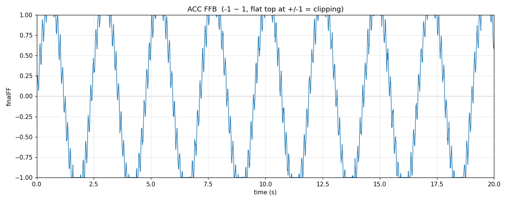

# ACC FFB Viewer

实时查看 Assetto Corsa Competizione 的力反馈（`finalFF`）曲线，用来判断 FFB 是否削峰（clipping）。

ACC 的 MoTeC 遥测文件里没有 FFB 通道，因此只能从游戏运行时的共享内存读取 —— 这个工具就是干这个的：一个窗口、一条曲线，外加自动记录 CSV 和事后回看。



## 功能

- **实时曲线**：纵轴固定 -1 ~ 1（超界时自动扩展），横轴 10 秒滚动窗口，左上角显示当前值、峰值和超过 1.0 的时间占比
- **自动记录**：数据同时写入 `logs/ffb_*.csv`，方便事后分析
- **回看分析**：`ffb_plot.py` 读 CSV 重画曲线，并统计贴顶占比、最长平顶时长，给出是否削峰的判断
- **无窗口记录**：`--csv-only --hz 200` 可以高采样率纯记录，适合做 gain 标定

## 安装

需要 Python 3.8+（Windows，ACC 运行在同一台机器上）：

```bash
pip install -r requirements.txt
```

## 使用

```bash
# 实时曲线 + 自动记录
python ffb_view.py

# 只看曲线，不记录
python ffb_view.py --no-log

# 不画图，200 Hz 纯记录（做削峰分析更准）
python ffb_view.py --csv-only --hz 200

# 回看最新一份记录
python ffb_plot.py

# 回看指定文件并导出 PNG
python ffb_plot.py --csv logs/ffb_20260101_120000.csv --out out.png
```

启动 `ffb_view.py` 后窗口会先出现并显示 `waiting for ACC ...`，启动 ACC 进赛道后自动开始画曲线。

## 判读削峰

- 曲线峰值/谷值**贴到 ±1 后变成水平平顶** → 削峰，游戏侧已经在截断信号
- 顶部保持尖峰、离参考线还有余量 → 没有削峰
- `ffb_plot.py` 会打印：99% 分位、贴顶时间占比、最长平顶时长，并给出结论

注意 `finalFF` 没有官方量纲，并不是严格的 ±1 归一化（实测可以超过 2）。图中的 ±1 只是参考线；真正"削峰到轮子"的位置还取决于轮基驱动的力度设置。要精确标定，可以固定一段弯，在 75% / 80% / 85% 的 gain 下各跑一遍，比较 99% 分位是否线性增长——涨不动了就是轮基到顶了。

## 文件

- `ffb_view.py` — 实时曲线 + CSV 记录
- `ffb_plot.py` — CSV 回看与削峰统计
- `acc_shm.py` — 最小化的 ACC 共享内存读取（ctypes + mmap）

## 说明

- 仅支持 Windows（ACC 共享内存是 Windows 命名内存映射）
- FFB 只在游戏运行时存在，`--seconds N` 可以让脚本跑 N 秒后自动退出
- 日志默认写到 `logs/`，已被 `.gitignore` 忽略

## License

GPL-3.0。`acc_shm.py` 的结构体布局参考了 Kunos 公布的 ACC shared memory 接口，字段顺序与 [pyacc](https://github.com/gotzl/pyacc)（GPLv3）一致。
